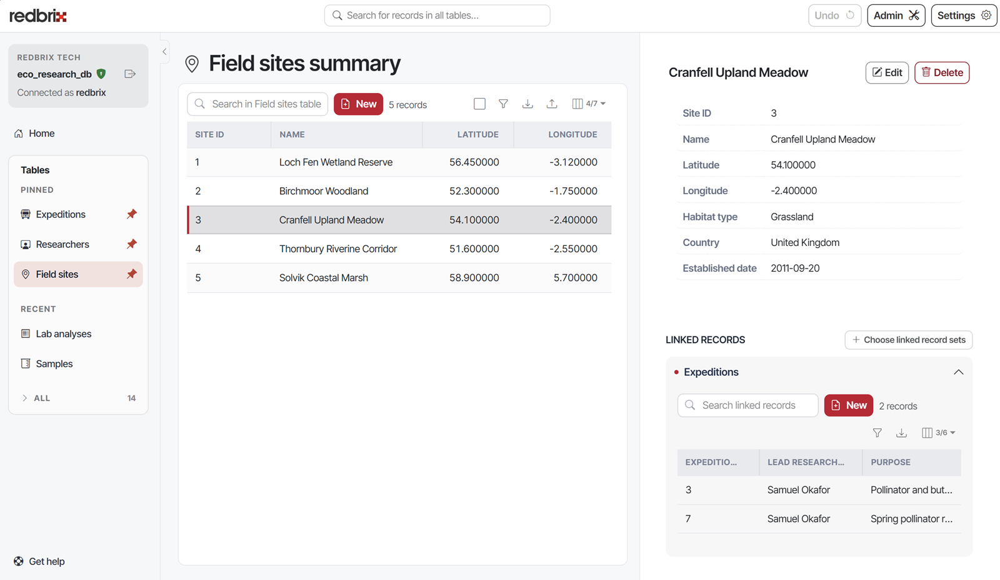

# Redbrix


Redbrix is third-party software, not developed or maintained by MariaDB and not included with MariaDB Server. MariaDB doesn't test, validate, or support it. Refer to its own documentation and license terms.


[Redbrix](https://redbrix.io) is a browser-based front end for MariaDB, MySQL and PostgreSQL databases that's designed
with **non-technical users** in mind. It creates an instant elegant, powerful interface for any database with minimal
configuration.

It requires the target database to be accessible from the Redbrix IP address over the designated server
port, or, alternatively, there is a self-hosted option for when access to your database over the public
internet is not an option. 

Read more at [redbrix.io](https://redbrix.io).

_This page is licensed: CC BY-SA / Gnu FDL_


